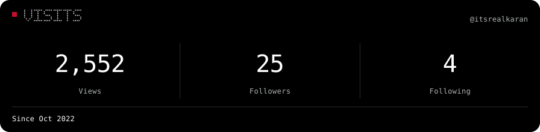
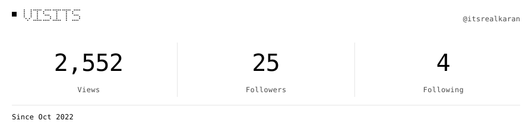
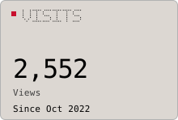
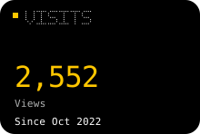

# itsrealkaran

Compact is the view count. Regular adds followers. Wide is one square per 100 views.

## classic

**visits** · classic · mini

`https://github.com/itsrealkaran/visits?username=itsrealkaran&theme=classic&size=mini`

**visits** · classic · compact

`https://github.com/itsrealkaran/visits?username=itsrealkaran&theme=classic&size=compact`

**visits** · classic · regular

`https://github.com/itsrealkaran/visits?username=itsrealkaran&theme=classic&size=regular`

**visits** · classic · wide

`https://github.com/itsrealkaran/visits?username=itsrealkaran&theme=classic&size=wide`

## classic-r

**visits** · classic-r · mini

`https://github.com/itsrealkaran/visits?username=itsrealkaran&theme=classic-r&size=mini`

**visits** · classic-r · compact

`https://github.com/itsrealkaran/visits?username=itsrealkaran&theme=classic-r&size=compact`

**visits** · classic-r · regular

`https://github.com/itsrealkaran/visits?username=itsrealkaran&theme=classic-r&size=regular`

**visits** · classic-r · wide

`https://github.com/itsrealkaran/visits?username=itsrealkaran&theme=classic-r&size=wide`

## white

**visits** · white · mini

`https://github.com/itsrealkaran/visits?username=itsrealkaran&theme=white&size=mini`

**visits** · white · compact

`https://github.com/itsrealkaran/visits?username=itsrealkaran&theme=white&size=compact`

**visits** · white · regular

`https://github.com/itsrealkaran/visits?username=itsrealkaran&theme=white&size=regular`

**visits** · white · wide

`https://github.com/itsrealkaran/visits?username=itsrealkaran&theme=white&size=wide`

## white-r

**visits** · white-r · mini

`https://github.com/itsrealkaran/visits?username=itsrealkaran&theme=white-r&size=mini`

**visits** · white-r · compact

`https://github.com/itsrealkaran/visits?username=itsrealkaran&theme=white-r&size=compact`

**visits** · white-r · regular

`https://github.com/itsrealkaran/visits?username=itsrealkaran&theme=white-r&size=regular`

**visits** · white-r · wide

`https://github.com/itsrealkaran/visits?username=itsrealkaran&theme=white-r&size=wide`

## light

**visits** · light · mini

`https://github.com/itsrealkaran/visits?username=itsrealkaran&theme=light&size=mini`

**visits** · light · compact

`https://github.com/itsrealkaran/visits?username=itsrealkaran&theme=light&size=compact`

**visits** · light · regular

`https://github.com/itsrealkaran/visits?username=itsrealkaran&theme=light&size=regular`

**visits** · light · wide

`https://github.com/itsrealkaran/visits?username=itsrealkaran&theme=light&size=wide`

## red

**visits** · red · mini

`https://github.com/itsrealkaran/visits?username=itsrealkaran&theme=red&size=mini`

**visits** · red · compact

`https://github.com/itsrealkaran/visits?username=itsrealkaran&theme=red&size=compact`

**visits** · red · regular

`https://github.com/itsrealkaran/visits?username=itsrealkaran&theme=red&size=regular`

**visits** · red · wide

`https://github.com/itsrealkaran/visits?username=itsrealkaran&theme=red&size=wide`

## blue

**visits** · blue · mini

`https://github.com/itsrealkaran/visits?username=itsrealkaran&theme=blue&size=mini`

**visits** · blue · compact

`https://github.com/itsrealkaran/visits?username=itsrealkaran&theme=blue&size=compact`

**visits** · blue · regular

`https://github.com/itsrealkaran/visits?username=itsrealkaran&theme=blue&size=regular`

**visits** · blue · wide

`https://github.com/itsrealkaran/visits?username=itsrealkaran&theme=blue&size=wide`

## yellow

**visits** · yellow · mini

`https://github.com/itsrealkaran/visits?username=itsrealkaran&theme=yellow&size=mini`

**visits** · yellow · compact

`https://github.com/itsrealkaran/visits?username=itsrealkaran&theme=yellow&size=compact`

**visits** · yellow · regular

`https://github.com/itsrealkaran/visits?username=itsrealkaran&theme=yellow&size=regular`

**visits** · yellow · wide

`https://github.com/itsrealkaran/visits?username=itsrealkaran&theme=yellow&size=wide`

