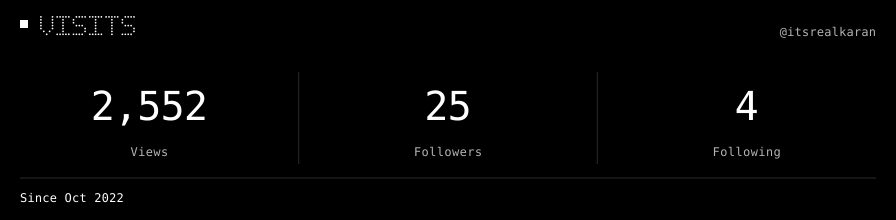
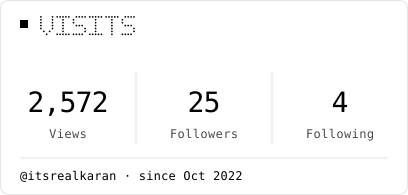
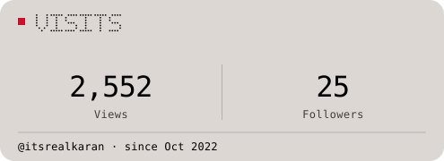
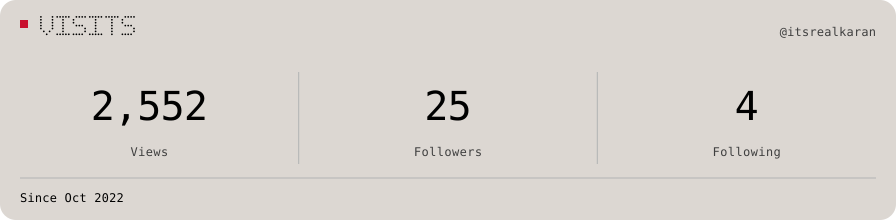
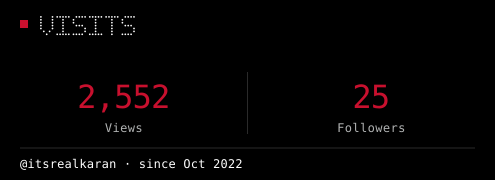
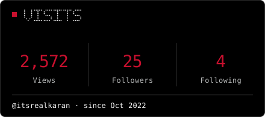
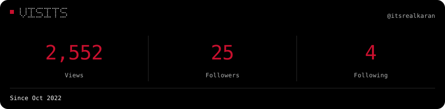
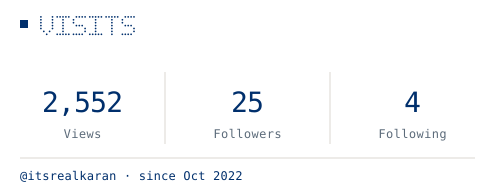
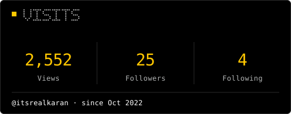
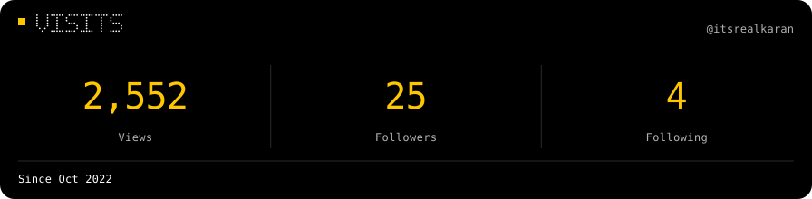

# itsrealkaran

Compact is the view count. Regular adds followers. Wide is one square per 100 views.

## classic

### compact

### regular

### wide

## white

### compact

### regular

### wide

## light

### compact

### regular

### wide

## red

### compact

### regular

### wide

## blue

### compact

### regular

### wide

## yellow

### compact

### regular

### wide

